<div align="center">

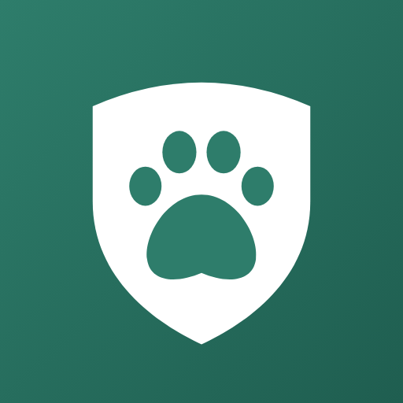

# Pawdian 毛孩守護

**疫苗、驅蟲、心絲蟲、餵藥準時提醒，體重與健康紀錄一手掌握**

不用註冊、沒有廣告，所有資料只存在你的手機上


[功能介紹](#-功能介紹) · [畫面一覽](#-畫面一覽) · [Pawdian Pro](#-pawdian-pro) · [隱私](#-隱私) · [開發者指南](#-開發者指南) · [English](#english)

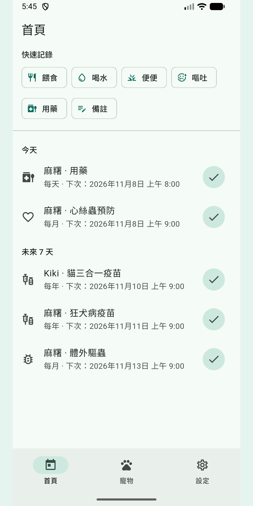&nbsp;&nbsp;
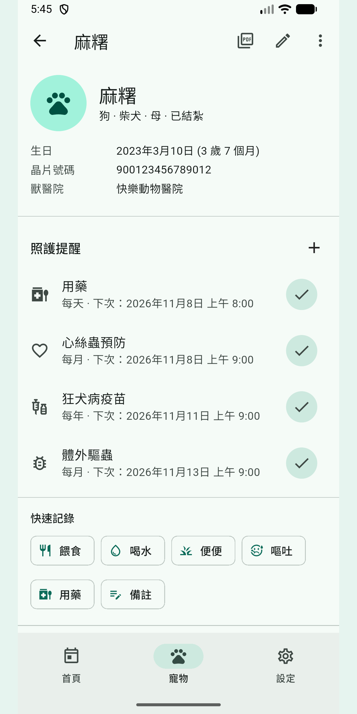&nbsp;&nbsp;
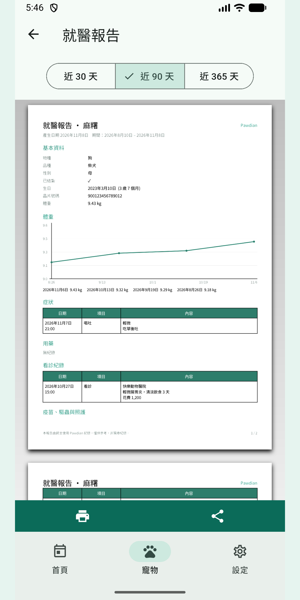

</div>

> [!NOTE]
> 這是**網頁伺服器版**分支（`feature/web-server`）：在 iPhone 的 Safari 使用、資料存在家裡的電腦、透過 Tailscale 連線，提醒用 Web Push 推送。設定方式見 **[docs/WEB_SERVER.md](docs/WEB_SERVER.md)**。Android 離線版請看 [`main` 分支](https://github.com/wyc915/Pawdian/tree/main)。

---

## 🐾 為什麼是 Pawdian

照顧毛孩最怕忘記：狂犬病疫苗多久打一次？上次驅蟲是哪天？今天的藥餵了沒？
Pawdian 把這些事情變成**準時的提醒**和**一鍵完成的紀錄**，看獸醫時還能直接拿出整理好的報告。

- **打開就能用**：不用帳號、不收集個人資料，所有紀錄只存在手機。
- **台灣在地**：內建台灣與美國常見的照護排程，例如台灣法規要求的狂犬病疫苗每年施打。
- **溫暖好用**：每隻寵物有自己的顏色，首頁一眼看到今天要做的事。

## ✨ 功能介紹

| | 功能 | 說明 |
|:-:|---|---|
| ⏰ | **照護提醒** | 疫苗、體內／體外驅蟲、心絲蟲、用藥、美容、健康檢查；每天／每週／每月／每年重複，一天可設定多個餵藥時間 |
| 🔔 | **通知上直接完成** | 通知上就有「完成」「1 小時後」「明天」按鈕，在背景處理，不用打開 App |
| 📋 | **建議排程範本** | 新增寵物時依台灣或美國常見頻率一鍵建立提醒（[頻率依據](docs/CARE_TEMPLATE_SOURCES.md)） |
| ⚡ | **2 秒快速記錄** | 餵食、喝水、便便、嘔吐、用藥……首頁彩色按鈕一按就記下；按鈕可自選、可拖曳排序 |
| 📝 | **健康與看診紀錄** | 症狀可標示輕微／中度／嚴重，看診可記錄醫院、診斷、花費，並附上照片 |
| 📈 | **體重曲線** | kg／lb 自動切換，1 個月到全部期間的趨勢圖 |
| 🗂️ | **時間軸** | 所有紀錄依日期排列，可分類篩選、搜尋備註 |
| 🏥 | **就醫報告 PDF** | 近 30／90／365 天的體重、症狀、用藥、看診一次整理，可列印或分享給獸醫 |
| 💾 | **備份與還原** | 一個檔案包含所有資料與照片，存雲端硬碟或寄給自己；另可匯出 CSV |
| 🏠 | **桌面小工具** | 在手機桌面直接看到下一個提醒 |
| 🌙 | **深色模式與中英切換** | 跟隨系統，也可以在 App 內切換語言 |

## 📱 畫面一覽

<table>
  <tr>
    <td align="center" width="33%"></td>
    <td align="center" width="33%"></td>
    <td align="center" width="33%">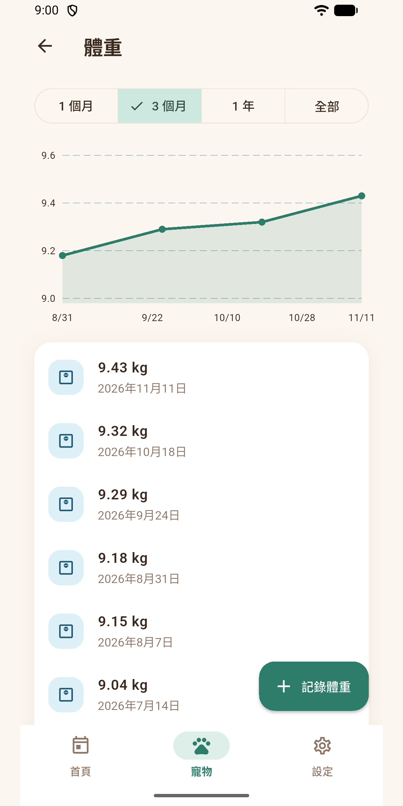</td>
  </tr>
  <tr>
    <td align="center"><b>首頁</b><br><sub>問候語與「下一個提醒」卡片，彩色快速記錄按鈕，今天與未來 7 天的待辦</sub></td>
    <td align="center"><b>寵物檔案</b><br><sub>每隻寵物專屬顏色，基本資料、照護提醒、快速記錄集中在一頁</sub></td>
    <td align="center"><b>體重曲線</b><br><sub>趨勢圖與完整歷史，1 個月、3 個月、1 年、全部期間切換</sub></td>
  </tr>
  <tr>
    <td align="center">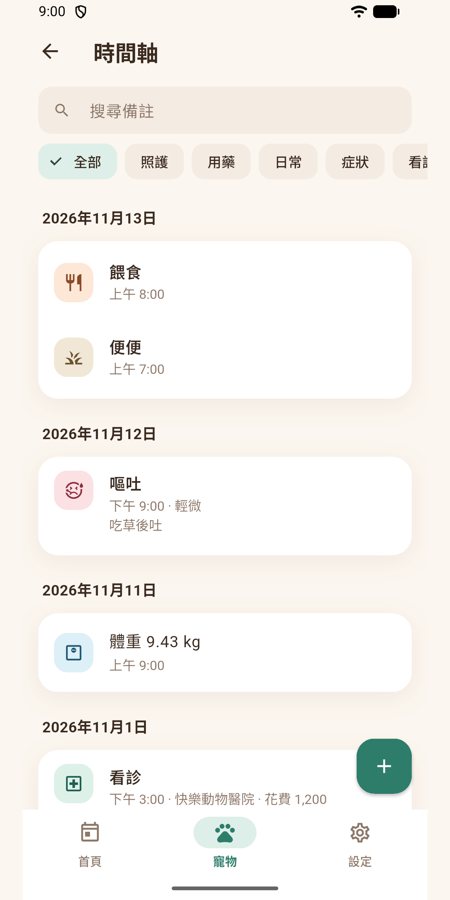</td>
    <td align="center"></td>
    <td align="center">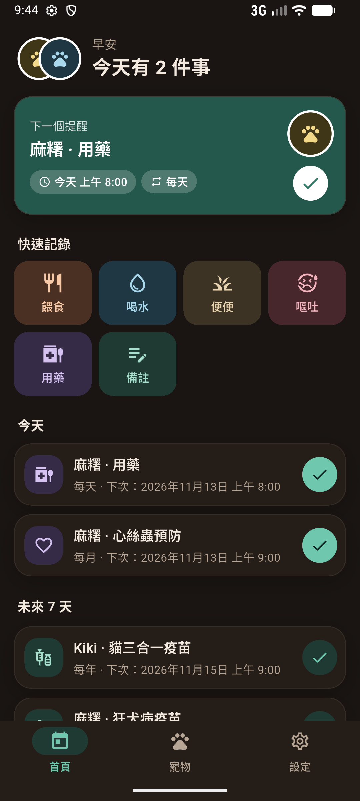</td>
  </tr>
  <tr>
    <td align="center"><b>時間軸</b><br><sub>依日期整理的所有紀錄，可篩選照護、用藥、日常、症狀、看診</sub></td>
    <td align="center"><b>就醫報告 PDF</b><br><sub>看獸醫時直接打開，體重、症狀、用藥與看診一目了然</sub></td>
    <td align="center"><b>深色模式</b><br><sub>夜間使用也舒服，顏色依系統自動切換</sub></td>
  </tr>
</table>

<details>
<summary><b>English screenshots</b></summary>
<br>
<table>
  <tr>
    <td align="center">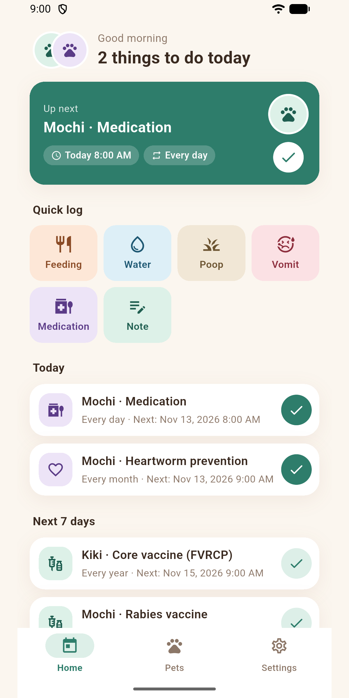<br><sub>Home</sub></td>
    <td align="center">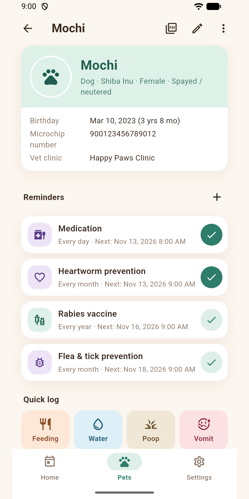<br><sub>Pet profile</sub></td>
    <td align="center">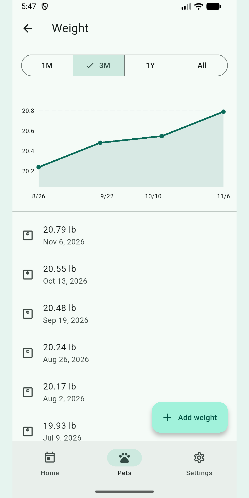<br><sub>Weight</sub></td>
    <td align="center">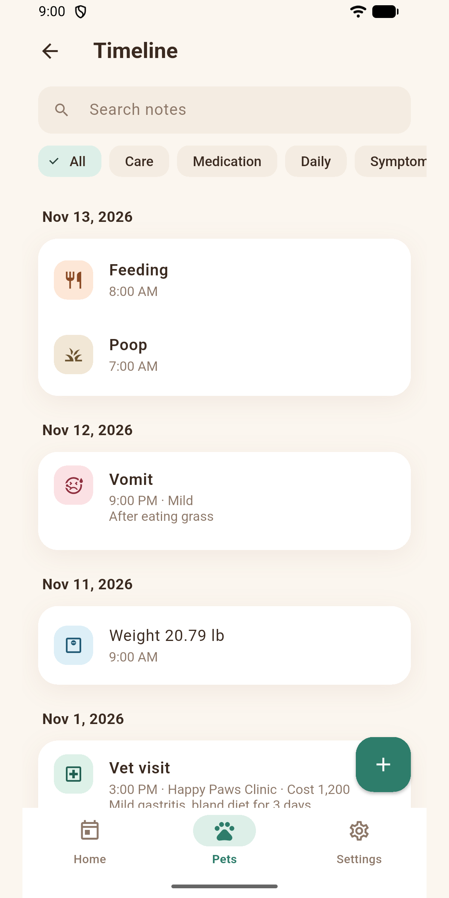<br><sub>Timeline</sub></td>
    <td align="center">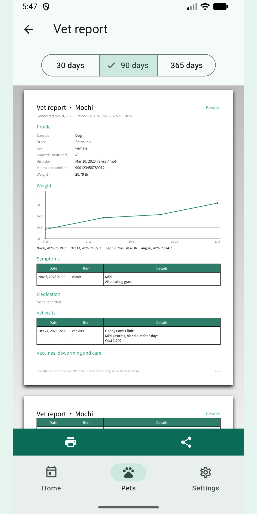<br><sub>Vet report</sub></td>
  </tr>
</table>
</details>

## 💎 Pawdian Pro

免費版就能使用完整的提醒與紀錄功能；Pro 適合多寵物家庭與需要整理就醫資料的飼主。

| 功能 | 免費版 | Pro |
|---|:-:|:-:|
| 照護提醒、通知按鈕、快速記錄、時間軸 | ✅ | ✅ |
| 備份與還原、桌面小工具 | ✅ | ✅ |
| 寵物數量 | 1 隻 | 不限 |
| 體重歷史 | 近 3 個月 | 全部 |
| 每筆紀錄的照片 | 1 張 | 不限 |
| 就醫報告 PDF | — | ✅ |
| 匯出 CSV | — | ✅ |

提供月訂閱、年訂閱與終身買斷，透過 Google Play 付款，訂閱可隨時取消。

## 🔒 隱私

- **不需要帳號**，不收集任何個人資料，沒有廣告、分析或追蹤工具。
- 寵物資料、紀錄與照片只存在手機的 App 私有空間；只有你主動建立的備份檔、CSV 或 PDF 會離開 App。
- 付款由 Google Play 處理，App 不會取得付款資料。
- 還原備份前會先檢查檔案完整性，損壞或可疑的檔案會被拒絕，原本的資料不受影響。
- 完整說明見[隱私權政策](site/privacy.html)。

> ⚠️ Pawdian 不提供醫療建議。建議排程與報告僅供參考，寵物的健康問題請諮詢獸醫師。

---

## 🛠 開發者指南

### 技術架構

| 項目 | 使用技術 |
|---|---|
| 框架 | Flutter 3.47／Dart 3.13（Android 優先，同一套程式碼可出 iOS 版） |
| 狀態管理 | Riverpod 3 |
| 頁面導覽 | go_router |
| 資料庫 | Drift（SQLite），含版本升級機制 |
| 通知 | flutter_local_notifications（精確鬧鐘、背景處理通知按鈕、重開機補排） |
| 付費 | in_app_purchase（Google Play Billing） |
| 報告 | pdf／printing，內嵌 Noto Sans TC 子集字型 |
| 視覺 | Material 3 自訂主題（`PawColors`）、flutter_animate、animations |

不需要伺服器：資料全部存在手機上，只有付款會連到 Google Play。資料表已預留 UUID、軟刪除與擁有者欄位，之後可以加上雲端同步與家人共享。

### 專案結構

```
lib/
  core/          資料庫、通知、付費、路由、設定、主題、檔案儲存
  features/      依功能分資料夾：home、pets、reminders、records、weight、
                 templates、report、backup、pro、settings
  shared/        共用元件（卡片、頭像、空白頁）與格式化工具
  l10n/          翻譯檔（app_en.arb、app_zh.arb）
android/         Android 設定、桌面小工具（Kotlin）、備份規則
test/            單元測試與畫面流程測試
tool/            商店素材產生工具、字型子集腳本與原始字型
store/           App 圖示、主題圖片、商店截圖
site/            隱私權政策與使用條款網站
docs/            規格書、上架指南、商店文案、範本依據、競品調查
```

### 開發環境

- Flutter stable 3.47.x（Dart 3.13）
- Android Studio（Android SDK 36／37、NDK 28.2）
- 開發機：Windows 10

### 常用指令

```bash
flutter pub get
flutter analyze
flutter test
flutter run                                   # 在模擬器或實機上執行
dart run build_runner build                   # 修改資料表後重新產生資料庫程式碼
flutter gen-l10n                              # 修改翻譯檔後重新產生
flutter test tool/generate_store_assets_test.dart   # 重新產生圖示、主題圖片與截圖排版
python tool/subset_font.py                    # 重新產生 PDF 用的字型子集
flutter build appbundle --release             # 上架檔，需先建立上傳金鑰
```

### 文件

| 文件 | 內容 |
|---|---|
| [docs/SPEC.md](docs/SPEC.md) | 產品與技術規格、待辦清單 |
| [docs/RELEASE.md](docs/RELEASE.md) | 上架操作指南：金鑰、Play Console、封閉測試 |
| [docs/STORE_LISTING.md](docs/STORE_LISTING.md) | 商店文案（中英）與資料安全性表單答案 |
| [docs/CARE_TEMPLATE_SOURCES.md](docs/CARE_TEMPLATE_SOURCES.md) | 照護範本頻率與資料來源 |
| [docs/COMPETITORS.md](docs/COMPETITORS.md) | Google Play 競品調查 |

### 注意事項

- 專案與 Flutter 套件快取在不同磁碟時，Kotlin 增量編譯會失敗，所以 `android/gradle.properties` 關閉了 `kotlin.incremental`。
- `flutter_local_notifications` 23 需要以 Android API 37 編譯（`compileSdk = 37`）。
- 正式版簽章讀取 `android/key.properties`（已排除於 Git）；沒有金鑰時，release APK 會改用 debug 金鑰，`flutter build appbundle` 則會直接中止。步驟見 [docs/RELEASE.md](docs/RELEASE.md)。

---

## English

**Pawdian** is a pet health app for Android: on-time reminders for vaccines, deworming, heartworm prevention and medication, plus weight tracking, daily logs and a vet report PDF.

- **No sign-up, no ads, no tracking.** Everything stays on your phone.
- **Done from the notification.** Mark a reminder done, or snooze it for an hour or until tomorrow, without opening the app.
- **Suggested schedules** for dogs and cats in Taiwan and the US.
- **Two-second logs** for feeding, water, poop, vomiting and more.
- **Vet report PDF**, weight charts, a searchable timeline, backup and restore, a home screen widget, dark mode, and English and Traditional Chinese.

Pawdian Pro adds unlimited pets, full weight history, unlimited photos, the vet report and CSV export, available as a monthly or yearly subscription or a one-time purchase.

> Pawdian does not provide medical advice. Always consult your veterinarian.

<p align="center"><sub>Made with 🐾 for pets and the people who love them.</sub></p>
