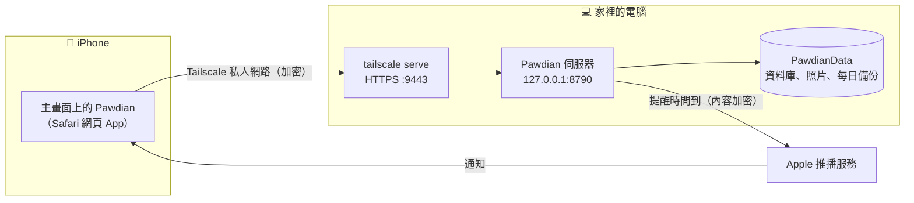

# 網頁伺服器版（iPhone 用）

`feature/web-server` 分支：在 **iPhone 的 Safari** 上使用 Pawdian，**資料存在家裡的電腦**，透過 **Tailscale** 私人網路連線，提醒用 **Web Push** 推到 iPhone。
同一份程式碼編譯成 Android 時，仍是原本的離線 App，不受影響。

## 系統架構



| 元件 | 角色 |
|---|---|
| 網頁 App（`flutter build web`） | 和手機版相同的畫面與功能；查詢透過連線在電腦上的資料庫執行 |
| 伺服器（`bin/pawdian_server.dart`） | 提供網頁、資料庫、照片與推播；只聽本機 `127.0.0.1`，區網連不到 |
| Tailscale serve | `https://<電腦名稱>.<tailnet>.ts.net:9443`，只有你 Tailscale 帳號內的裝置連得到 |
| Web Push | 你開 App 時會把未來 30 天的提醒排程交給伺服器，時間到由伺服器經 Apple 推播服務送到 iPhone；內容以 RFC 8291 加密，Apple 看不到內容 |

**這台電腦上的 Tailscale 服務（不要互相覆蓋）**

| 網址連接埠 | 轉到本機 | 用途 |
|---|---|---|
| 443 | 127.0.0.1:8080 | 其他服務 |
| 8443 | 127.0.0.1:8787 | FitLog |
| **9443** | **127.0.0.1:8790** | **Pawdian** |
| 10443 | 127.0.0.1:3311 | 其他服務 |

**資料位置**：`%USERPROFILE%\PawdianData\`

| 檔案 | 內容 |
|---|---|
| `pawdian.sqlite` | 所有寵物、提醒、紀錄、體重 |
| `pet_photos\`、`attachments\` | 照片 |
| `snapshots\` | 每天自動備份一份資料庫，保留 30 天 |
| `push\` | 推播金鑰、已訂閱的裝置、提醒排程 |
| `passcode.txt` | 通行碼（每台裝置第一次連線時輸入） |

> 這個資料夾就是你的全部資料，請定期另外備份（例如複製到雲端硬碟或隨身碟）。

## 第一次設定（電腦）

需要 [Flutter](https://docs.flutter.dev/get-started/install) 與 [Tailscale](https://tailscale.com/download)。在專案資料夾：

```bash
git checkout feature/web-server
flutter pub get
flutter build web
tool\start_server.bat            # 或 dart run bin/pawdian_server.dart
```

視窗會顯示網址、資料夾與**通行碼**。另開一個終端機（只需設定一次）：

```bash
tailscale serve --bg --https=9443 http://127.0.0.1:8790
tailscale serve status
```

> [!CAUTION]
> 一定要帶 `--https=9443`。不帶的寫法會佔用 443，**蓋掉其他服務**。不要執行 `tailscale serve reset`（會清掉全部服務），也**不要用 `tailscale funnel`**（會公開到網際網路）。

**開機自動啟動（建議）**：執行一次，之後登入 Windows 就會自動開啟伺服器（縮小視窗）。

```powershell
powershell -ExecutionPolicy Bypass -File tool\install_autostart.ps1
```

取消：按 Win+R 輸入 `shell:startup`，刪除「Pawdian server」捷徑。

## 第一次設定（iPhone，需要 iOS 16.4 以上）

1. 安裝 **Tailscale** App，用與電腦相同的帳號登入並開啟。
2. 用 **Safari** 開 `https://desktop-qkv133v.tail87ae4f.ts.net:9443`，輸入電腦上顯示的**通行碼**。
3. 點「分享 › **加入主畫面**」。**之後一律從主畫面的 Pawdian 開啟**（Safari 分頁裡收不到推播）。
4. 從主畫面開啟後：設定 › 通知 › 點「通知：未允許，點此開啟」，允許通知。
5. 點「**傳送測試通知**」，確認 iPhone 有收到。

## 日常使用

| 情況 | 要做的事 |
|---|---|
| 電腦開著、伺服器在跑 | 什麼都不用做 |
| 電腦重開機 | 有設定自動啟動就不用做事；沒有的話執行 `tool\start_server.bat` |
| 更新程式（`git pull`） | `flutter build web`，然後重新啟動伺服器；手機重新開啟 App 就是新版 |
| 很久沒開 App | 至少每個月開一次 App，伺服器上的提醒排程（未來 30 天）才會延續 |

**收不到提醒時檢查**
1. 電腦是否開機、**沒有睡眠**（電源設定的睡眠建議改成「永不」），伺服器視窗是否開著。
2. iPhone 的 Tailscale 是否連線（推播本身不需要 Tailscale，但開 App 更新排程需要）。
3. 是否從**主畫面**開啟並已允許通知；設定裡按「傳送測試通知」試試。
4. `tailscale serve status` 中 `:9443` 是否仍指向 `127.0.0.1:8790`。

## 和手機版的差異

| 功能 | 網頁伺服器版 |
|---|---|
| 資料 | 存在電腦，多台裝置共用同一份；和 Android 版的資料**不會同步** |
| 提醒 | Web Push；點通知會開啟 App 到該寵物頁，通知上沒有「完成／稍後」按鈕 |
| Pro 功能 | 全部開放 |
| 備份 | 伺服器每天自動備份；App 內不提供備份檔匯出／還原（CSV 匯出仍可用） |
| 桌面小工具 | 不提供 |

## 開發說明

- 伺服器程式在 `lib/server/`（純 Dart，不依賴 Flutter），網頁端在 `lib/web/`。
- 資料庫連線使用 drift 的遠端協定（WebSocket，JSON 編碼），所以網頁版沿用手機版的所有查詢與資料庫升級。
- 測試：`test/web_server_test.dart`（伺服器、共用資料庫、照片、推播排程）、`test/web_push_test.dart`（加密結果與 RFC 8291 範例一致、VAPID 簽章）。
